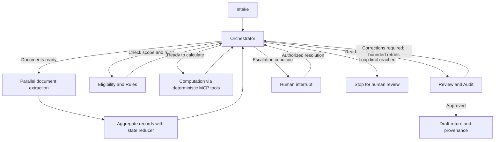

# SilverFile — Team Workspace

A collaborative starter repository for the team's seven-person SilverFile project: six agents plus a dashboard/demo workstream.

**Status: planning scaffold. The tax application is not implemented yet.**

## Start here

1. Check your assigned workstream in [TEAM.md](TEAM.md) and provide your GitHub username to the repository owner.
2. Follow the individual schedule in the [team planning document](https://docs.google.com/document/d/1tkAG7Xk9ocj3Wmg04FzHj_xkaeI4_IxfM0N6yviZj9s/edit?tab=t.0) and milestones in [TASKS.md](TASKS.md).
3. Read [CONTRIBUTING.md](CONTRIBUTING.md) before editing.
4. Agree on the shared interfaces in [docs/ARCHITECTURE.md](docs/ARCHITECTURE.md).

## Product goal

Collect synthetic taxpayer information, extract tax-document values, and generate a draft 2025 Form 1040-SR with inspectable provenance for every monetary value. Provide an employee dashboard and resumable human review.

The system must never file returns or provide tax advice. Use synthetic data only; user-entered SSNs must start with 900–999. Do not commit real tax documents, credentials, or API keys.

## Proposed workflow

This is a proposed architecture, not evidence of implemented functionality. Intake is the only agent that converses with the taxpayer; the orchestrator only routes work.

## Repository map

| Location | Purpose |
|---|---|
| `src/agents/` | Six distinct agents |
| `src/tools/` | Deterministic MCP calculation tools |
| `data/fixtures/` | Synthetic tax documents and test inputs |
| `evals/` | Evaluation scenarios |
| `tests/` | Routing, reducer, calculation, and loop-guard tests |
| `traces/` | Sanitized execution evidence |
| `docs/` | Architecture, metrics, implementation notes, AI disclosure |
| `demo/` | Clean and human-intervention demo instructions and video |

## Running the project

There is no runnable application yet. Python/LangGraph is the proposed implementation approach. The team must add and verify dependency versions, a real entry point, environment configuration, and exact run commands before submission.

## Acceptance targets

- Six distinct agents; conditional routing; genuine parallel work and safe aggregation.
- Bounded review/revise loop and a tested pathological-handoff guard.
- W-2 image extraction; required 1040-SR fields; deterministic MCP calculations.
- Inspectable provenance for every monetary value.
- LangGraph interrupts and successful resume after human resolution.
- Employee dashboard; persistent session state; at least four demonstrated accessibility choices.
- Clean and resolved-HITL examples; support for grader-created inputs.
- Actual token-count comparison with context management enabled/disabled.
- Reproducible setup, contribution records, detailed AI disclosure, and a 5–10 minute demo.

## Before submission

Confirm the current deadline and all grading details in Canvas. Check [docs/OPEN_QUESTIONS.md](docs/OPEN_QUESTIONS.md) against class Q&A notes. This repository summarizes implementation targets; it does not reproduce restricted course materials.
