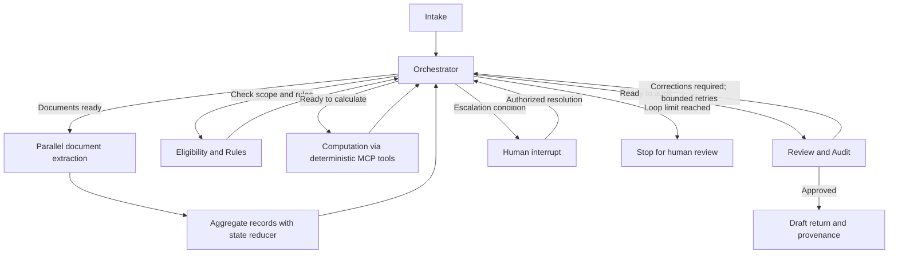

# SilverFile — Team Workspace

A shared workspace for the team's seven-person SilverFile project: six agents plus a dashboard/demo workstream.

**Status checked October 26, 2026, with the October 26 pull requests merged: all six agents run together in the production graph. Both eval cases go from a W-2 image to a draft 1040-SR (`draft_ready`) through real OCR, Intake, Rules, Computation and Review; eval case 2 stops for staff (E6) and resumes. Still open: actual API token counts for spec 4.5, the human spreadsheet check of the golden returns, the report and the demo video.**

## Team roles and focus areas

| Focus area | Team member assigned | Workstream |
|---|---|---|
| Agent memory | Zimo (P3) | Intake agent, session summaries, context strategy |
| Inter-agent communication | Jad (P2) | Computation agent, MCP tax tools, report |
| Task division and management | Kaiwen (P1) | Shared contracts, graph, routing, persistence, loop guards |
| MLOps/DevOps | Ziling (P6) | Review agent, CI, Docker |
| Guardrails and ethics | Lluc (P5) | Eligibility & Rules agent, policy corpus, escalations E1–E8 |
| Security | Christina (P4) | W-2 extraction, SSN rule, PII masking, fixtures |
| To confirm with the instructor (seven-person team) | David (P7) | Staff dashboard, taxpayer page, form output, demo video |

## Current implementation

| Owner | Component | Current state | Details |
|---|---|---|---|
| P1 — Kaiwen | Contracts, orchestration, checkpoints, interrupts, guards | Implemented | [P1 handoff](docs/IMPLEMENTATION_NOTES.md) |
| P2 — Jad | Computation and deterministic MCP tools | Implemented; golden returns need a human spreadsheet check | [Computation](docs/P2_COMPUTATION.md) |
| P3 — Zimo | Conversational Intake, memory and context strategy | Implemented; actual token counts pending (`docs/metrics.md`) | [Intake integration](docs/P1_INTAKE_HANDOFF.md) |
| P4 — Christina | W-2 image extraction, security and fixtures | Implemented | [Extraction](docs/P4_EXTRACTION_SECURITY.md) |
| P5 — Lluc | Eligibility, Rules and escalations | Implemented | [Rules interface](docs/p5_rules_interface.md) |
| P6 — Ziling | Review, CI and Docker | Implemented; both eval cases run in Docker | [Review](docs/P6_REVIEW.md) |
| P7 — David | Staff dashboard, taxpayer page, HTML/PDF output | Implemented; demo video pending | [Dashboard](docs/P7_DASHBOARD.md) |

`python run.py ... --demo` is a separate routing demonstration with placeholder
Extraction, Computation and Review; it never calculates a return. Without `--demo`, the
production agents run.

## Start here

1. Check your assigned workstream in [TEAM.md](TEAM.md) and provide your GitHub username to the repository owner.
2. Follow the individual schedule in the [team planning document](https://docs.google.com/document/d/1tkAG7Xk9ocj3Wmg04FzHj_xkaeI4_IxfM0N6yviZj9s/edit?tab=t.0) and milestones in [TASKS.md](TASKS.md).
3. Read [CONTRIBUTING.md](CONTRIBUTING.md) before editing.
4. Agree on the shared interfaces in [docs/ARCHITECTURE.md](docs/ARCHITECTURE.md).

## Product goal

Collect synthetic taxpayer information, extract tax-document values, and generate a draft 2025 Form 1040-SR with inspectable provenance for every monetary value. Provide an employee dashboard and resumable human review.

The system must never file returns or provide tax advice. Use synthetic data only; user-entered SSNs must start with 900–999. Do not commit real tax documents, credentials, or API keys.

## Proposed workflow



The P1 routing topology is implemented; the offline demo still uses placeholder adapters for unfinished workstreams. Intake is the only agent that converses with the taxpayer; the orchestrator only routes work.

## Repository map

| Location | Purpose |
|---|---|
| `src/agents/` | Intake, Extraction, Rules, Computation and Review (`run(state) -> dict` each) |
| `src/prompts/` | Model prompts (R7) |
| `src/graph.py`, `src/memory.py`, `src/state.py` | Routing, SQLite sessions and shared contracts |
| `src/demo_agents.py` | Explicit offline placeholders, separate from production adapters |
| `streamlit_app.py`, `src/dashboard/` | Staff UI, resolution, provenance and form rendering |
| `src/tools/` | Deterministic MCP calculation tools |
| `tests/golden/` | Synthetic computation cases; human cross-check still required |
| `data/policy.md` | Policy corpus the Rules agent cites |
| `data/fixtures/`, `evals/` | Synthetic W-2 images (incl. the 10-document batch) and evaluation scenarios |
| `tests/` | Routing, reducer, calculation, and loop-guard tests |
| `traces/` | Sanitized execution evidence |
| `docs/` | Architecture, metrics, implementation notes, AI disclosure |
| `demo/` | Eval cases 1 and 2 with their W-2 images and instructions; video pending |
| `.github/workflows/ci.yml` | Python 3.11 tests and selected golden-return reviews |
| `Dockerfile`, `docker-compose.yml` | Container setup and dashboard service |

## Running the project

Use Python 3.11 (team target and CI configuration). Run the current tests in your own
environment; do not treat a historical test count as the latest CI result.

```sh
python -m venv .venv
```

Activate with `.venv\Scripts\Activate.ps1` on Windows PowerShell or `source .venv/bin/activate` on macOS/Linux. Then:

```sh
python -m pip install -r requirements.txt
python -m pytest -q
python run.py start --demo --thread-id first-demo
```

Reading W-2 images (both eval cases in `demo/`) also needs the Tesseract OCR program,
which pip cannot install: `brew install tesseract` (macOS), `sudo apt-get install
tesseract-ocr` (Ubuntu), or the UB Mannheim installer (Windows). Without it the image
tests are skipped and an image upload stops with an "OCR is not installed" error. The
Docker image and CI already include it.

The `--demo` run uses placeholder Extraction/Computation/Review and ends as
**scaffold_complete**, not a tax return. See [persistent human-review walkthrough](demo/P1_WALKTHROUGH.md).

**The real system (eval cases).** No API key is needed:

```sh
python run.py start --input demo/eval_case_1_input.json --thread-id eval-case-1   # draft_ready
python run.py start --input demo/eval_case_2_input.json --thread-id eval-case-2   # awaiting_human (E6)
python run.py resume --thread-id eval-case-2 --input demo/eval_case_2_resolution.json
```

Full instructions and expected values: [eval case 1](demo/eval_case_1.md), [eval case 2](demo/eval_case_2.md).
Runtime SQLite files live under ignored `runtime/`; use the same `--db` and `--thread-id`
for resume. `SILVERFILE_DB` optionally sets the database path.

**Context-window batch (spec 4.5).** Needs `ANTHROPIC_API_KEY` and `SILVERFILE_MODEL` in
`.env` (`--estimate` runs offline with estimated counts):

```sh
python run.py batch --no-context-strategy
python run.py batch
```

Both rebuild [docs/metrics.md](docs/metrics.md).

### Staff dashboard

Copy `.env.example` to `.env` and set the staff variables there. Never commit `.env`.
In PowerShell, use `Copy-Item .env.example .env`; on macOS/Linux, use
`cp .env.example .env`. The included sign-in values are for synthetic local demos.

```sh
python run.py start --demo --hitl --thread-id dashboard-hitl
python -m streamlit run streamlit_app.py
```

Open http://localhost:8501. Sign in with the configured staff ID and passcode to resolve
an escalation; without them, the dashboard is read-only. The CLI and dashboard must use
the same database. Set `SILVERFILE_DB` in the shell for CLI commands if changing the
default; the Streamlit entry point also loads `.env`.

Sessions started without `--demo` (for example the eval cases) show the computed draft
form with hover and click provenance. Demo sessions are routing examples and show no form
lines; **Sample returns** shows the golden returns. The **Taxpayer** page
accepts W-2 uploads when a return is started. See [dashboard walkthrough](demo/P7_DASHBOARD_WALKTHROUGH.md).

### Docker

With a running Docker engine and Docker Compose:

```sh
docker compose up --build
```

Open http://localhost:8501. Compose provides synthetic staff credentials by default
(`demo_staff` / `silverfile-demo`); `.env` can override them. Session data is stored in
the named `silverfile-runtime` volume. The entrypoint seeds the routing-demo sessions;
they are not completed tax returns.

```sh
docker compose run --rm silverfile python -m pytest -q
docker compose down
```

The P6 task update reports a successful macOS Docker run. This README update has not
independently rerun Docker. CI configuration runs tests and reviews golden cases g01,
g05 and g06; check the latest [Actions results](https://github.com/54161251/silverfile/actions)
for actual outcomes. Cases g02–g04 still need 1099-R distribution-code fixture alignment.


## Integration and submission work still open

- Run the spec 4.5 batch with the team key so `docs/metrics.md` shows actual API counts.
- Human-check the golden returns in a spreadsheet (R12).
- An unreadable document can only be recovered by staff entering its boxes one escalation
  at a time; documents cannot be added to a running session.
- Traces, report and demo video; P3 and P4 AI-log entries (see `docs/AI_DISCLOSURE.md`).
- Repair golden fixtures g02–g04 (1099-R box 7) so CI can review them too.

These are integration tasks, not claims that all current component tests fail. See
[TASKS.md](TASKS.md) and the linked owner notes for details and evidence.

## Keeping this README current

**Every contributor updates documentation in the same PR as their feature.** A separate
README-only PR is also welcome for corrections. You do not need P1 permission for routine
updates or to merge your tested PR when no major issues remain.

| If your change affects… | Update… |
|---|---|
| Implemented features or remaining gaps | Current implementation table and open-work list above |
| Installation, dependencies or environment variables | Setup commands, requirements.txt and .env.example |
| CLI, dashboard or Docker behavior | Relevant run instructions and walkthrough |
| Shared state, agent outputs or handoffs | Owner's document in docs/ and coordinate with affected owners |
| Tests or verification | PR verification section with command, environment and actual result |

Before merging: pull the latest main, edit the relevant section rather than rewriting the
whole file, check local links, and run any changed commands you can verify. Label commands
or outcomes you could not verify. If documentation is unaffected, say why in the PR.
Resolve README merge conflicts by keeping both contributors' valid updates.

Keep this page as the short project entry point. Put detailed workstream notes in
`docs/` and link them here. Only mark work complete after the stated behavior is verified;
sample data, mock adapters and component tests do not prove the complete workflow.

## Acceptance targets

- Six distinct agents; conditional routing; genuine parallel work and safe aggregation.
- Bounded review/revise loop and a tested pathological-handoff guard.
- W-2 image extraction; required 1040-SR fields; deterministic MCP calculations.
- Inspectable provenance for every monetary value.
- LangGraph interrupts and successful resume after human resolution.
- Employee dashboard; persistent session state; at least four demonstrated accessibility choices.
- Clean and resolved-HITL examples; support for grader-created inputs.
- Actual token-count comparison with context management enabled/disabled.
- Reproducible setup, contribution records, detailed AI disclosure, and a 5–10 minute demo.

## Before submission

Confirm the current deadline and all grading details in Canvas. Check [docs/OPEN_QUESTIONS.md](docs/OPEN_QUESTIONS.md) against class Q&A notes. This repository summarizes implementation targets; it does not reproduce restricted course materials.
