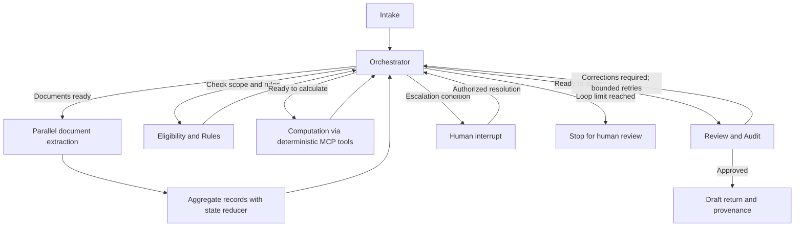

# SilverFile — Team Workspace

A shared workspace for the team's seven-person SilverFile project: six agents plus a dashboard/demo workstream.

**Status checked October 25, 2026: orchestration, basic interactive Intake, Rules, Computation, Review, the staff dashboard, form rendering, CI and Docker configuration are present. Intake's remaining tax questions and production Extraction are still pending; a complete taxpayer-to-draft workflow is not yet demonstrated.**

## Current implementation

| Owner | Component | Current state | Details |
|---|---|---|---|
| P1 — Kaiwen | Contracts, orchestration, checkpoints, interrupts, guards | Implemented; document correction/versioning needs integration | [P1 handoff](docs/IMPLEMENTATION_NOTES.md) |
| P2 — Jad | Computation and deterministic MCP tools | Implemented; golden returns need human verification | [Computation](docs/P2_COMPUTATION.md) |
| P3 — Zimo | Conversational Intake, memory and context metrics | Five-question interactive Intake connected; remaining questions, taxpayer page and metrics pending | [Intake integration](docs/P1_INTAKE_HANDOFF.md) |
| P4 — Christina | W-2 image extraction, security and fixtures | Production adapter and assignment demo fixtures pending | [Tasks](TASKS.md) |
| P5 — Lluc | Eligibility, Rules and escalations | Implemented | [Rules interface](docs/p5_rules_interface.md) |
| P6 — Ziling | Review, CI and Docker | Implemented; full grader simulation pending | [Review](docs/P6_REVIEW.md) |
| P7 — David | Staff dashboard, human resolution, HTML/PDF output | Implemented; final demo video pending | [Dashboard](docs/P7_DASHBOARD.md) |

“Implemented” describes a component, not acceptance of the complete application. The
offline graph uses real interactive Intake and Rules, with placeholder Extraction,
Computation and Review adapters; it does not calculate a tax return. The dashboard's
**Sample returns** tab separately invokes real Computation on golden data. These are
different demonstrations.

## Start here

1. Check your assigned workstream in [TEAM.md](TEAM.md) and provide your GitHub username to the repository owner.
2. Follow the individual schedule in the [team planning document](https://docs.google.com/document/d/1tkAG7Xk9ocj3Wmg04FzHj_xkaeI4_IxfM0N6yviZj9s/edit?tab=t.0) and milestones in [TASKS.md](TASKS.md).
3. Read [CONTRIBUTING.md](CONTRIBUTING.md) before editing.
4. Agree on the shared interfaces in [docs/ARCHITECTURE.md](docs/ARCHITECTURE.md).

## Product goal

Collect synthetic taxpayer information, extract tax-document values, and generate a draft 2025 Form 1040-SR with inspectable provenance for every monetary value. Provide an employee dashboard and resumable human review.

The system must never file returns or provide tax advice. Use synthetic data only; user-entered SSNs must start with 900–999. Do not commit real tax documents, credentials, or API keys.

## Proposed workflow



The P1 routing topology is implemented; the offline demo still uses placeholder adapters for unfinished workstreams. Intake is the only agent that converses with the taxpayer; the orchestrator only routes work.

## Repository map

| Location | Purpose |
|---|---|
| `src/agents/` | Basic interactive Intake, Rules, Computation and Review; Extraction pending |
| `src/graph.py`, `src/memory.py`, `src/state.py` | Routing, SQLite sessions and shared contracts |
| `src/demo_agents.py` | Explicit offline placeholders, separate from production adapters |
| `streamlit_app.py`, `src/dashboard/` | Staff UI, resolution, provenance and form rendering |
| `src/tools/` | Deterministic MCP calculation tools |
| `tests/golden/` | Synthetic computation cases; human cross-check still required |
| `data/fixtures/`, `evals/` | Reserved for assignment fixtures and evaluation scenarios |
| `tests/` | Routing, reducer, calculation, and loop-guard tests |
| `traces/` | Sanitized execution evidence |
| `docs/` | Architecture, metrics, implementation notes, AI disclosure |
| `demo/` | Current walkthroughs; final assignment cases and video pending |
| `.github/workflows/ci.yml` | Python 3.11 tests and selected golden-return reviews |
| `Dockerfile`, `docker-compose.yml` | Container setup and dashboard service |

## Running the project

Use Python 3.11 (team target and CI configuration). Run the current tests in your own
environment; do not treat a historical test count as the latest CI result.

```sh
python -m venv .venv
```

Activate with `.venv\Scripts\Activate.ps1` on Windows PowerShell or `source .venv/bin/activate` on macOS/Linux. Then:

```sh
python -m pip install -r requirements.txt
python -m pytest -q
python run.py start --demo --thread-id first-demo
```

The demo uses synthetic structured documents, real Intake and Rules, and placeholder
Extraction/Computation/Review adapters. It ends as **scaffold_complete**, not a
completed tax return. No API key is needed. See [persistent human-review walkthrough](demo/P1_WALKTHROUGH.md)
and [integration handoff](docs/IMPLEMENTATION_NOTES.md).

For the eventual production agents, each module exposes `run(state) -> dict` under
`src/agents/`. `python run.py start --input path/to/synthetic-input.json` deliberately
fails until the missing adapters are supplied. Runtime SQLite files live under ignored
`runtime/`; use the same `--db` and `--thread-id` for resume. `SILVERFILE_DB` optionally
sets the database path. P1 uses no API credentials; model configuration belongs to the
agent owners.

### Staff dashboard

Copy `.env.example` to `.env` and set the staff variables there. Never commit `.env`.
In PowerShell, use `Copy-Item .env.example .env`; on macOS/Linux, use
`cp .env.example .env`. The included sign-in values are for synthetic local demos.

```sh
python run.py start --demo --hitl --thread-id dashboard-hitl
python -m streamlit run streamlit_app.py
```

Open http://localhost:8501. Sign in with the configured staff ID and passcode to resolve
an escalation; without them, the dashboard is read-only. The CLI and dashboard must use
the same database. Set `SILVERFILE_DB` in the shell for CLI commands if changing the
default; the Streamlit entry point also loads `.env`.

Use **Sample returns** for computed HTML/PDF previews. Demo sessions remain routing
examples and show no computed form lines. See [dashboard walkthrough](demo/P7_DASHBOARD_WALKTHROUGH.md).

### Docker

With a running Docker engine and Docker Compose:

```sh
docker compose up --build
```

Open http://localhost:8501. Compose provides synthetic staff credentials by default
(`demo_staff` / `silverfile-demo`); `.env` can override them. Session data is stored in
the named `silverfile-runtime` volume. The entrypoint seeds the routing-demo sessions;
they are not completed tax returns.

```sh
docker compose run --rm silverfile python -m pytest -q
docker compose down
```

The P6 task update reports a successful macOS Docker run. This README update has not
independently rerun Docker. CI configuration runs tests and reviews golden cases g01,
g05 and g06; check the latest [Actions results](https://github.com/54161251/silverfile/actions)
for actual outcomes. Cases g02–g04 still need 1099-R distribution-code fixture alignment.


## Integration and submission work still open

- Complete Intake's required tax questions and connect Extraction, the taxpayer page, Computation and Review in one workflow.
- Define corrected-document replacement/versioning so corrections cannot double-count income.
- Connect staff-entered 1099-R taxable amounts to Computation (E3); the dashboard alone is insufficient.
- Move remaining income summation and direct-input rounding out of Computation into MCP tools.
- Align the extraction confidence threshold across workstreams and repair incomplete golden fixtures.
- Human-check golden returns; run clean and resolved-HITL cases through the real graph.
- Complete context-token measurements, required W-2 images, traces, report, AI disclosure and video.

These are integration tasks, not claims that all current component tests fail. See
[TASKS.md](TASKS.md) and the linked owner notes for details and evidence.

## Keeping this README current

**Every contributor updates documentation in the same PR as their feature.** A separate
README-only PR is also welcome for corrections. You do not need P1 permission for routine
updates or to merge your tested PR when no major issues remain.

| If your change affects… | Update… |
|---|---|
| Implemented features or remaining gaps | Current implementation table and open-work list above |
| Installation, dependencies or environment variables | Setup commands, requirements.txt and .env.example |
| CLI, dashboard or Docker behavior | Relevant run instructions and walkthrough |
| Shared state, agent outputs or handoffs | Owner's document in docs/ and coordinate with affected owners |
| Tests or verification | PR verification section with command, environment and actual result |

Before merging: pull the latest main, edit the relevant section rather than rewriting the
whole file, check local links, and run any changed commands you can verify. Label commands
or outcomes you could not verify. If documentation is unaffected, say why in the PR.
Resolve README merge conflicts by keeping both contributors' valid updates.

Keep this page as the short project entry point. Put detailed workstream notes in
`docs/` and link them here. Only mark work complete after the stated behavior is verified;
sample data, mock adapters and component tests do not prove the complete workflow.

## Acceptance targets

- Six distinct agents; conditional routing; genuine parallel work and safe aggregation.
- Bounded review/revise loop and a tested pathological-handoff guard.
- W-2 image extraction; required 1040-SR fields; deterministic MCP calculations.
- Inspectable provenance for every monetary value.
- LangGraph interrupts and successful resume after human resolution.
- Employee dashboard; persistent session state; at least four demonstrated accessibility choices.
- Clean and resolved-HITL examples; support for grader-created inputs.
- Actual token-count comparison with context management enabled/disabled.
- Reproducible setup, contribution records, detailed AI disclosure, and a 5–10 minute demo.

## Before submission

Confirm the current deadline and all grading details in Canvas. Check [docs/OPEN_QUESTIONS.md](docs/OPEN_QUESTIONS.md) against class Q&A notes. This repository summarizes implementation targets; it does not reproduce restricted course materials.
