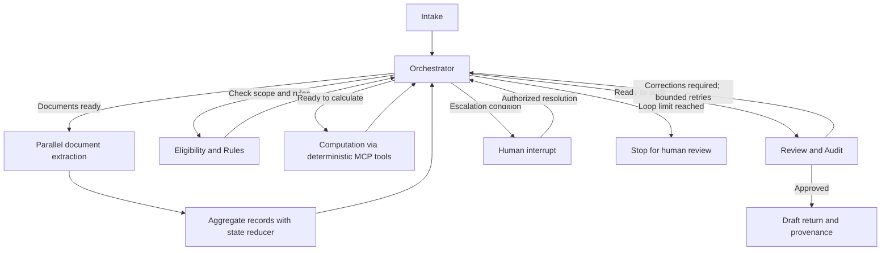

# SilverFile — Team Workspace

A shared workspace for the team's seven-person SilverFile project: six agents plus a dashboard/demo workstream.

**Status checked October 30, 2026 (main at `117ce39`): all six agents run as real adapters. `python run.py start --input ...` takes both evaluation cases to `draft_ready` (case 2 after staff resolve E6), the full test suite passed locally (Python 3.12.15; CI uses 3.11), and goldens g01-g06 pass Review. Not demonstrated in this repo: the demo video and a Docker run by the person who last edited this page (see [Docker](#docker)). Read [Known limits](#known-limits) before relying on a return.**

## Current implementation

| Owner | Component | Current state | Details |
|---|---|---|---|
| P1 — Kaiwen | Contracts, orchestration, checkpoints, interrupts, guards | Implemented; document correction/versioning needs integration | [P1 handoff](docs/IMPLEMENTATION_NOTES.md) |
| P2 — Jad | Computation and deterministic MCP tools | Implemented; golden returns need human verification | [Computation](docs/P2_COMPUTATION.md) |
| P3 — Zimo | Conversational Intake, memory and context metrics | Interactive Intake (core questions; optional "other amounts" questions, see Known limits), taxpayer page and context-strategy metrics implemented | [Intake integration](docs/P1_INTAKE_HANDOFF.md) |
| P4 — Christina | W-2 image extraction, security and fixtures | Implemented: W-2 image OCR (Tesseract), SSN rule, PII masking, synthetic fixtures and eval inputs | [Tasks](TASKS.md) |
| P5 — Lluc | Eligibility, Rules and escalations | Implemented | [Rules interface](docs/p5_rules_interface.md) |
| P6 — Ziling | Review, CI and Docker | Implemented; grader simulation recorded in [P6_GRADER_SIM](docs/P6_GRADER_SIM.md) | [Review](docs/P6_REVIEW.md) |
| P7 — David | Staff dashboard, human resolution, HTML/PDF output | Implemented; the demo video is not in this repo | [Dashboard](docs/P7_DASHBOARD.md) |

“Implemented” describes a component, not acceptance of the complete application.
`python run.py start --input ...` runs the real agents (production mode). `--demo` runs the
routing skeleton with real Intake and Rules but placeholder Extraction, Computation and Review;
it ends as `scaffold_complete` and calculates no tax. The dashboard's **Sample returns** tab
separately invokes real Computation on golden data. These are different demonstrations.

## Start here

1. Check your assigned workstream in [TEAM.md](TEAM.md) and provide your GitHub username to the repository owner.
2. Follow the individual schedule in the [team planning document](https://docs.google.com/document/d/1tkAG7Xk9ocj3Wmg04FzHj_xkaeI4_IxfM0N6yviZj9s/edit?tab=t.0) and milestones in [TASKS.md](TASKS.md).
3. Read [CONTRIBUTING.md](CONTRIBUTING.md) before editing.
4. Agree on the shared interfaces in [docs/ARCHITECTURE.md](docs/ARCHITECTURE.md).

## Product goal

Collect synthetic taxpayer information, extract tax-document values, and generate a draft 2025 Form 1040-SR with inspectable provenance for every monetary value. Provide an employee dashboard and resumable human review.

The system must never file returns or provide tax advice. Use synthetic data only; user-entered SSNs must start with 900–999. Do not commit real tax documents, credentials, or API keys.

## Proposed workflow



The routing topology is implemented; only `--demo` uses placeholder adapters. Intake is the only agent that converses with the taxpayer; the orchestrator only routes work.

## Repository map

| Location | Purpose |
|---|---|
| `src/agents/` | Intake, Extraction, Rules, Computation and Review (plus Intake's document briefing) |
| `src/graph.py`, `src/memory.py`, `src/state.py` | Routing, SQLite sessions and shared contracts |
| `src/demo_agents.py` | Placeholders for `--demo` only, separate from production adapters |
| `streamlit_app.py`, `src/dashboard/` | Staff UI, resolution, provenance and form rendering |
| `src/tools/` | Deterministic MCP calculation tools |
| `tests/golden/` | Synthetic computation cases; human cross-check still required |
| `data/fixtures/`, `evals/` | Synthetic W-2 images, the 10-document batch, evaluation case definitions and grader-simulation inputs |
| `tests/` | Routing, reducer, calculation, and loop-guard tests |
| `traces/` | Sanitized traces of both eval cases (rebuild: `python traces/make_traces.py`) |
| `docs/` | Architecture, metrics, implementation notes, AI disclosure |
| `demo/` | Eval case walkthroughs and inputs, dashboard walkthrough |
| `.github/workflows/ci.yml` | Python 3.11: full test suite, then Review of goldens g01-g06 |
| `Dockerfile`, `docker-compose.yml` | Container setup and dashboard service |

## Running the project

### Install

Use Python 3.11 (team target and CI configuration; the suite also passed on 3.12.15). Reading
W-2 images also needs the Tesseract OCR program, which pip cannot install: `brew install
tesseract` (macOS), `sudo apt-get install tesseract-ocr` (Ubuntu), or the UB Mannheim installer
(Windows). Without it the image tests are skipped and an image upload stops with an "OCR is not
installed" error. The Docker image and CI already include it.

```sh
python -m venv .venv
source .venv/bin/activate          # Windows PowerShell: .venv\Scripts\Activate.ps1
python -m pip install -r requirements.txt
```

### Run the tests

```sh
python -m pytest -q
for g in tests/golden/g0[1-6]_*.json; do python -m src.agents.review "$g" | head -1; done   # each prints "verdict: pass"
```

Do not treat a historical test count as the latest CI result; check the
[Actions results](https://github.com/54161251/silverfile/actions).

### Run the two evaluation cases (real adapters, no API key)

Each case needs a new `--thread-id` (reusing one fails with "Cannot complete operation (ValueError)"). Sessions are
saved in `runtime/sessions.sqlite` (or `--db` / `SILVERFILE_DB`). Full walkthroughs:
[case 1](demo/eval_case_1.md), [case 2](demo/eval_case_2.md).

```sh
# Case 1: clean run, ends draft_ready, line 34 refund = 2,650
python run.py start --input demo/eval_case_1_input.json --thread-id eval-case-1
python run.py status --thread-id eval-case-1

# Case 2: stops at E6 (awaiting_human), staff resolve, ends draft_ready, line 34 refund = 1,995
python run.py start  --input demo/eval_case_2_input.json --thread-id eval-case-2
python run.py status --thread-id eval-case-2
python run.py resume --input demo/eval_case_2_resolution.json --thread-id eval-case-2
python run.py status --thread-id eval-case-2
```

Case 2 can also be resolved in the dashboard (steps in `demo/eval_case_2.md`). To try your own
W-2, make a synthetic image with `python data/generate_fixtures.py --custom my_w2.jpg --wages ...
--withheld ... --ssn 900-11-2222 --name "Sam Placeholder"`, copy `demo/eval_case_1_input.json`,
and point `source_file` at your image (see "Make your own clean case" in `demo/eval_case_1.md`).
SSNs must be in the 900-999 test range; a W-2 showing any other SSN stops the session at E7.

### Provide your own API key

Tests, the eval cases and the dashboard need no key. Only `python run.py batch` (the spec 4.5
token measurement) calls the model. The code looks for `ANTHROPIC_API_KEY` in this order:

1. a real environment variable;
2. `.env` (copy `.env.example` and fill in `ANTHROPIC_API_KEY=`);
3. `api_key.txt` (copy `api_key.example.txt`, put the key on its own line).

`.env` and `api_key.txt` are gitignored; never commit them. A blank value counts as missing.
`SILVERFILE_MODEL` in `.env` chooses the model.

```sh
python run.py batch --no-context-strategy   # context strategy off: full history resent
python run.py batch                         # context strategy on
python run.py batch --estimate              # no key, no API call; estimates only (rewrites docs/metrics.md)
```

Without a key, `run.py batch` exits with "No API key found..." and does not print a traceback.
Results are written to `docs/metrics.md`.

### Offline routing demo

```sh
python run.py start --demo --thread-id first-demo
```

This uses synthetic structured documents, real Intake and Rules, and placeholder
Extraction/Computation/Review adapters. It ends as **scaffold_complete**, not a completed tax
return. See the [persistent human-review walkthrough](demo/P1_WALKTHROUGH.md) and
[integration handoff](docs/IMPLEMENTATION_NOTES.md). Use the same `--db` and `--thread-id` to
resume.

### Staff dashboard

Copy `.env.example` to `.env` and set the staff variables there. Never commit `.env`.
In PowerShell, use `Copy-Item .env.example .env`; on macOS/Linux, use
`cp .env.example .env`. The included sign-in values are for synthetic local demos.

```sh
python run.py start --demo --hitl --thread-id dashboard-hitl
python -m streamlit run streamlit_app.py
```

Open http://localhost:8501. Sign in with the configured staff ID and passcode to resolve
an escalation; without them, the dashboard is read-only. The CLI and dashboard must use
the same database. Set `SILVERFILE_DB` in the shell for CLI commands if changing the
default; the Streamlit entry point also loads `.env`.

Use **Sample returns** for computed HTML/PDF previews. Demo sessions remain routing
examples and show no computed form lines. See [dashboard walkthrough](demo/P7_DASHBOARD_WALKTHROUGH.md).

### Docker

With a running Docker engine and Docker Compose:

```sh
docker compose up --build
```

Open http://localhost:8501. Compose provides synthetic staff credentials by default
(`demo_staff` / `silverfile-demo`); `.env` can override them. Session data is stored in
the named `silverfile-runtime` volume. The entrypoint seeds the routing-demo sessions;
they are not completed tax returns.

```sh
docker compose run --rm silverfile python -m pytest -q
docker compose down
```

Docker was not re-run when this page was updated. P6 recorded a macOS Docker build and both
eval cases run in the container ([P6_GRADER_SIM](docs/P6_GRADER_SIM.md)). To run a case in a
running container: `docker compose exec silverfile python run.py start --input
demo/eval_case_1_input.json --thread-id eval-case-1` (that exact command line was not run by the
person who wrote this note). To give the container an API key, put it in `.env`; Compose passes
`.env` into the container as environment variables (`env_file`) and does not copy it into the
image. CI runs the full test suite and reviews goldens g01-g06 (g02-g04 now carry the 1099-R
code and pass Review locally); check the
[Actions results](https://github.com/54161251/silverfile/actions) for actual outcomes.


## Known limits

- **Some lines are entered as 0 unless supplied.** Form 1040-SR lines 8, 10, 17, 19, 20, 23, 25c
  and 26 default to 0 with kind `default_zero` (shown on the dashboard) when no value is given.
  Intake asks for lines 8, 10, 17, 19, 20, 23 and 26 only when Computation names one as missing,
  which it does not today, and never asks for 25c. A taxpayer with, say, estimated payments
  (line 26) who is not asked can get a draft that **understates the refund**. Staff must check
  these lines.
- **Extraction reads W-2 images only.** 1099-INT, 1099-DIV, 1099-R and SSA-1099 values, and the
  1099-R keys `ira_sep_simple` and `qcd_amount`, work through structured input only, not OCR.
- Line 16 uses the rate schedule, not the qualified-dividend worksheet, so tax can differ from
  commercial software (assumption A14). More limits: [docs/P2_COMPUTATION.md](docs/P2_COMPUTATION.md).

## Open submission work

- Human re-derivation of the golden returns (R12): so far only AI-assisted checks are recorded.
- Demo video, five-page report, and verifying setup on another teammate's machine.

See [TASKS.md](TASKS.md) and the linked owner notes for details and evidence.

## Keeping this README current

**Every contributor updates documentation in the same PR as their feature.** A separate
README-only PR is also welcome for corrections. You do not need P1 permission for routine
updates or to merge your tested PR when no major issues remain.

| If your change affects… | Update… |
|---|---|
| Implemented features or remaining gaps | Current implementation table and open-work list above |
| Installation, dependencies or environment variables | Setup commands, requirements.txt and .env.example |
| CLI, dashboard or Docker behavior | Relevant run instructions and walkthrough |
| Shared state, agent outputs or handoffs | Owner's document in docs/ and coordinate with affected owners |
| Tests or verification | PR verification section with command, environment and actual result |

Before merging: pull the latest main, edit the relevant section rather than rewriting the
whole file, check local links, and run any changed commands you can verify. Label commands
or outcomes you could not verify. If documentation is unaffected, say why in the PR.
Resolve README merge conflicts by keeping both contributors' valid updates.

Keep this page as the short project entry point. Put detailed workstream notes in
`docs/` and link them here. Only mark work complete after the stated behavior is verified;
sample data, mock adapters and component tests do not prove the complete workflow.

## Acceptance targets

- Six distinct agents; conditional routing; genuine parallel work and safe aggregation.
- Bounded review/revise loop and a tested pathological-handoff guard.
- W-2 image extraction; required 1040-SR fields; deterministic MCP calculations.
- Inspectable provenance for every monetary value.
- LangGraph interrupts and successful resume after human resolution.
- Employee dashboard; persistent session state; at least four demonstrated accessibility choices.
- Clean and resolved-HITL examples; support for grader-created inputs.
- Actual token-count comparison with context management enabled/disabled.
- Reproducible setup, contribution records, detailed AI disclosure, and a 5–10 minute demo.

## Before submission

Confirm the current deadline and all grading details in Canvas. Check [docs/OPEN_QUESTIONS.md](docs/OPEN_QUESTIONS.md) against class Q&A notes. This repository summarizes implementation targets; it does not reproduce restricted course materials.
