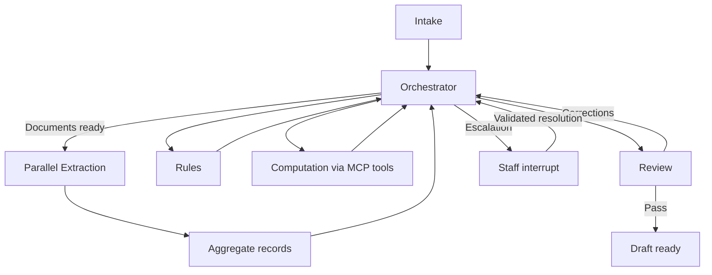

# SilverFile

A multi-agent tax-preparation prototype for **ENMGT 5405, Assignment 7**. SilverFile collects
synthetic taxpayer information, reads W-2 images, and prepares a draft 2025 Form 1040-SR
with inspectable sources and calculations. Staff resolve escalations through a dashboard
and resume the same saved session.

**Draft preparation only. SilverFile does not file returns or provide tax advice.** Use
synthetic documents and test SSNs beginning with 900–999.

## Project report

[System design report (Google Docs)](https://docs.google.com/document/d/1I3Q8qCJq-R8rYF7ioCXAVgKd34_t4ra_ssrpvkP8DVI/edit) ·
[Report PDF](Extra%20Credit%20Report%20SilverFile.pdf)

The report covers the architecture, agent responsibilities, safety boundaries, failure modes
and team contributions. The report describes an earlier project snapshot;
current setup, input coverage and technical limitations are documented below, with
updated measurements and AI-use records linked under evaluation evidence.

## System overview

Six agents share validated state in a LangGraph workflow:

| Agent | Responsibility |
|---|---|
| Orchestrator | Selects the next step, prioritizes escalations, and limits stalled handoffs and review revisions |
| Intake | Asks one question at a time, records answers, and returns risk flags to Rules |
| Extraction | Reads W-2 images/PDFs with Tesseract; retains sources, confidence scores and unverified boxes |
| Rules | Checks eligibility, scope, missing information and escalation conditions against the policy corpus |
| Computation | Calls deterministic MCP tax-math tools and records provenance for return lines |
| Review | Checks the draft and sends findings to the responsible upstream agent |

Extraction workers process uploads in parallel; a reducer combines their records.
SQLite checkpoints support taxpayer continuation and staff interrupt/resume. The
Streamlit app includes taxpayer upload/questions, a staff queue, return details, and
HTML/PDF output with provenance.



See [architecture](docs/ARCHITECTURE.md) and [implementation notes](docs/IMPLEMENTATION_NOTES.md)
for state contracts, routing and persistence.

## Setup

Use **Python 3.11**, the CI target. W-2 image extraction also requires the Tesseract
program: install it with `brew install tesseract` on macOS, `sudo apt-get install
tesseract-ocr` on Ubuntu, or the UB Mannheim Windows installer. Pip dependencies alone
do not install the OCR engine.

From the repository root:

```sh
python -m venv .venv
```

Activate the environment:

- macOS/Linux: `source .venv/bin/activate`
- Windows PowerShell: `.venv\Scripts\Activate.ps1`

Then install dependencies:

```sh
python -m pip install -r requirements.txt
```

The production return workflow and tests do not require a model API key. The optional
context-measurement batch uses a model; its setup is described below.

## Run the evaluation cases

These commands use the real agents and W-2 images. Use a fresh thread ID for each new
case. Session data is saved in `runtime/sessions.sqlite`; `--db` or `SILVERFILE_DB`
can select another database. Use the same database and thread ID when resuming.

### Case 1: clean return

```sh
python run.py start --input demo/eval_case_1_input.json --thread-id eval-clean
python run.py status --thread-id eval-clean
```

Recorded expected result: `draft_ready`, with line 34 refund **2,650**.
[Case details and synthetic inputs](demo/eval_case_1.md).

### Case 2: staff review and resume

```sh
python run.py start --input demo/eval_case_2_input.json --thread-id eval-hitl
python run.py status --thread-id eval-hitl
python run.py resume --thread-id eval-hitl --input demo/eval_case_2_resolution.json
python run.py status --thread-id eval-hitl
```

The case pauses at E6 for staff review. After the supplied resolution, the recorded
expected result is `draft_ready`, with line 34 refund **1,995**. The same resolution can
be entered through the staff dashboard. [Case walkthrough](demo/eval_case_2.md).

### Taxpayer and staff interface

Copy `.env.example` to `.env` (`Copy-Item .env.example .env` in PowerShell, or
`cp .env.example .env` on macOS/Linux), then run:

```sh
python -m streamlit run streamlit_app.py
```

Open **http://localhost:8501**. The taxpayer page supports W-2 uploads, one question at a
time and saved-session continuation. Staff sign in using the configured staff ID and
passcode to resolve escalations. Without staff credentials, staff views are read-only.
The app and CLI must use the same database. The app loads `.env`; set `SILVERFILE_DB`
in the CLI environment too if changing the default location.

Production sessions display their computed return once draft-ready. **Sample returns**
provides a separate preview based on golden data. See the
[dashboard walkthrough](demo/P7_DASHBOARD_WALKTHROUGH.md) and
[interface notes](docs/P7_DASHBOARD.md).

### Docker

```sh
docker compose up --build
```

Open **http://localhost:8501**. Compose supplies synthetic staff credentials
(`demo_staff` / `silverfile-demo`), which `.env` can override. Data persists in the
`silverfile-runtime` volume.

The entrypoint seeds routing examples using `--demo`; these are not completed returns.
To run a production evaluation in the running container:

```sh
docker compose exec silverfile python run.py start --input demo/eval_case_1_input.json --thread-id docker-clean
```

```sh
docker compose run --rm silverfile python -m pytest -q
docker compose down
```

P6's recorded Docker runs and grader-created cases are in the
[grader simulation](docs/P6_GRADER_SIM.md).

## Tests and evaluation evidence

```sh
python -m pytest -q
```

[GitHub Actions](https://github.com/54161251/silverfile/actions) installs Tesseract, runs
the full suite on Python 3.11, and computes/reviews golden cases g01–g06. Without a
local OCR engine, image-dependent tests are skipped; check the reported skips when
interpreting local results.

- [Evaluation traces](traces/): sanitized checkpoints, routing, staff decisions and final lines.
- [Grader simulation](docs/P6_GRADER_SIM.md): both evaluation cases and additional synthetic inputs.
- [Context measurements](docs/metrics.md): actual API input tokens with the strategy enabled and disabled.
- [AI-use disclosure](docs/AI_DISCLOSURE.md): assistance used, individual logs and verification limits.

### Context-window comparison

The batch processes ten W-2 images for one household. Full history resends earlier
documents and briefings; selective recall uses the current document and a bounded
summary. Recorded input at document ten was **3,031 tokens** with full history and
**1,040 tokens** with selective recall. The metrics page separates actual usage from
offline estimates.

```sh
python run.py batch --no-context-strategy
python run.py batch
```

These commands need Tesseract and an Anthropic API key. Keys are checked in this order:
`ANTHROPIC_API_KEY` in the environment, `.env`, then the ignored `api_key.txt` file
(copy `api_key.example.txt`). The first non-blank value is used. `SILVERFILE_MODEL` is
optional and defaults to `claude-opus-5-5`. Never commit keys or real tax documents.

`python run.py batch --estimate` uses no model API call but still needs OCR. It updates
the estimate table while preserving committed actual measurements.

## Known limitations

- **Document coverage:** OCR reads W-2 images/PDFs. Other supported forms (1099-INT,
  1099-DIV, 1099-R and SSA-1099) currently require structured input. 1099-R
  `ira_sep_simple` and `qcd_amount` are structured fields.
- **Direct-entry amounts:** unsupplied lines may default to zero. Intake has optional
  questions for lines 8, 10, 17, 19, 20, 23 and 26, but default-zero behavior can bypass
  them; line 25c has no question. Staff must check these amounts.
- **Tax method:** qualified dividends use ordinary rates under assumption A14 rather
  than the qualified-dividend/capital-gain worksheet. See [Computation notes](docs/P2_COMPUTATION.md).
- **Document corrections:** existing IDs are extracted once. Replacement/supersession
  is not implemented; adding a corrected document under a new ID can double-count income.
- **Validation:** golden results have AI-assisted IRS-source/spreadsheet checks;
  independent human re-derivation is not recorded. This remains a prototype, not a
  professionally validated tax-preparation service.
- **Storage and concurrency:** SQLite and local provenance files are prototype storage;
  production deployment needs stronger access, retention and concurrent-resolution controls.

The `--demo` option runs a routing scaffold with placeholder Extraction, Computation
and Review adapters and ends as `scaffold_complete`. Use the production commands above
for a calculated return. [Routing walkthrough](demo/P1_WALKTHROUGH.md).

## Team and project files

| Contributor | Main workstream |
|---|---|
| Kaiwen Ji | Orchestration, shared state, persistence and integration |
| Jad Karaki | Computation, MCP tools, golden cases and report |
| Zimo Li | Intake, session summaries and context metrics |
| Christina Boehm | Extraction, security and synthetic fixtures |
| Lluc Farrés | Rules, policy citations and escalations |
| Ziling Yan | Review, QA, CI and Docker |
| David Tamen | Taxpayer/staff interfaces, provenance display and demo |

[Team responsibilities](TEAM.md) · [Contribution guide](CONTRIBUTING.md) ·
[Work tracker](TASKS.md)

| Location | Contents |
|---|---|
| `src/agents/`, `src/tools/` | Specialist agents and deterministic MCP tools |
| `src/graph.py`, `src/state.py`, `src/memory.py` | Workflow, contracts and checkpoints |
| `streamlit_app.py`, `src/ui/`, `src/dashboard/` | Taxpayer and staff interfaces |
| `data/fixtures/`, `evals/`, `demo/` | Synthetic documents, test scenarios and walkthroughs |
| `tests/`, `tests/golden/` | Automated checks and golden inputs/results |
| `docs/`, `traces/` | Technical notes, disclosure, measurements and execution evidence |
