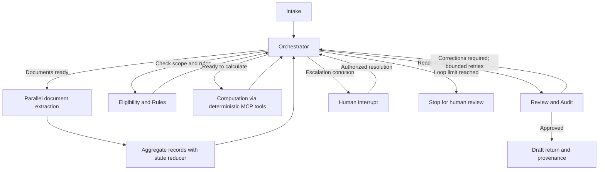
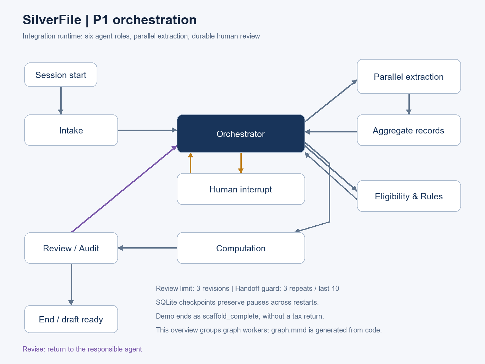

# SilverFile — Team Workspace

A shared workspace for the team's seven-person SilverFile project: six agents plus a dashboard/demo workstream.

**Status checked October 30, 2026 against main `117ce39`: all six agent modules, the taxpayer page, W-2 upload, staff dashboard, form output, CI and Docker configuration are present. Real API context-token measurements and sanitized evaluation traces are committed. Submission is not yet signed off: the Intake risk-flag handoff still needs a fix and final image-based regression checks.**

## Current implementation

| Owner | Component | Current state | Details |
|---|---|---|---|
| P1 — Kaiwen | Orchestration, shared contracts, persistence, interrupts and guards | Implemented; corrected-document replacement remains open | [P1 handoff](docs/IMPLEMENTATION_NOTES.md) |
| P2 — Jad | Computation and deterministic MCP tools | Implemented; staff box overrides and tool-based summation/rounding connected; independent human golden re-derivation remains open | [Computation](docs/P2_COMPUTATION.md) |
| P3 — Zimo | Intake, summaries and context metrics | Expanded questions and direct-entry lines connected; real token counts recorded; risk flags can remain inside Intake instead of reaching Rules | [Metrics](docs/metrics.md) |
| P4 — Christina | W-2 OCR, security and fixtures | Tesseract extraction, synthetic W-2s, ten-document household batch and eval fixtures merged | [Extraction](docs/P4_EXTRACTION_SECURITY.md) |
| P5 — Lluc | Rules and escalations | Implemented, including unreadable-document and low-confidence checks | [Rules interface](docs/p5_rules_interface.md) |
| P6 — Ziling | Review, CI, Docker and evaluation evidence | Golden cases g01–g06 reviewed in CI; traces and grader simulation recorded; final-revision rerun still needed | [Grader simulation](docs/P6_GRADER_SIM.md) |
| P7 — David | Taxpayer uploads, staff resolution and HTML/PDF output | Implemented; final video and final report delivery links still need confirmation | [Dashboard](docs/P7_DASHBOARD.md) |

Production mode loads real Intake, Extraction, Rules, Computation and Review agents. The
`--demo` mode deliberately uses placeholder Extraction/Computation/Review adapters and
ends as `scaffold_complete`; it does not calculate a return. Dashboard sample returns
are a separate Computation preview. Use the production evaluation commands below to
check the actual graph.

## Start here

1. Check your assigned workstream in [TEAM.md](TEAM.md) and provide your GitHub username to the repository owner.
2. Follow the individual schedule in the [team planning document](https://docs.google.com/document/d/1tkAG7Xk9ocj3Wmg04FzHj_xkaeI4_IxfM0N6yviZj9s/edit?tab=t.0) and milestones in [TASKS.md](TASKS.md).
3. Read [CONTRIBUTING.md](CONTRIBUTING.md) before editing.
4. Agree on the shared interfaces in [docs/ARCHITECTURE.md](docs/ARCHITECTURE.md).

## Product goal

Collect synthetic taxpayer information, extract tax-document values, and generate a draft 2025 Form 1040-SR with inspectable provenance for every monetary value. Provide an employee dashboard and resumable human review.

The system must never file returns or provide tax advice. Use synthetic data only; user-entered SSNs must start with 900–999. Do not commit real tax documents, credentials, or API keys.

## Proposed workflow



The routing topology and production adapters are implemented; the offline demo retains explicit placeholder adapters. Intake is the only agent that converses with the taxpayer; the orchestrator only routes work.

## Repository map

| Location | Purpose |
|---|---|
| `src/agents/` | Intake, Extraction, Rules, Computation and Review; document briefing for the batch command |
| `src/graph.py`, `src/memory.py`, `src/state.py` | Routing, SQLite sessions and shared contracts |
| `src/demo_agents.py` | Explicit offline placeholders, separate from production adapters |
| `streamlit_app.py`, `src/dashboard/` | Staff UI, resolution, provenance and form rendering |
| `src/tools/` | Deterministic MCP calculation tools |
| `tests/golden/` | Synthetic computation cases; human cross-check still required |
| `data/fixtures/`, `evals/` | Synthetic W-2 images, a ten-document household batch and evaluation scenarios |
| `tests/` | Routing, reducer, calculation, and loop-guard tests |
| `traces/` | Sanitized execution evidence |
| `docs/` | Architecture, metrics, implementation notes, AI disclosure |
| `demo/` | Evaluation inputs and walkthroughs; final video link not yet confirmed |
| `.github/workflows/ci.yml` | Python 3.11 tests and selected golden-return reviews |
| `Dockerfile`, `docker-compose.yml` | Container setup and dashboard service |

## Running the project

Use Python 3.11 (team target and CI configuration). Run the current tests in your own
environment; do not treat a historical test count as the latest CI result.

```sh
python -m venv .venv
```

Activate with `.venv\Scripts\Activate.ps1` on Windows PowerShell or `source .venv/bin/activate` on macOS/Linux. Then:

```sh
python -m pip install -r requirements.txt
python -m pytest -q
python run.py start --demo --thread-id first-demo
```

Reading W-2 images (both eval cases in `demo/`) also needs the Tesseract OCR program,
which pip cannot install: `brew install tesseract` (macOS), `sudo apt-get install
tesseract-ocr` (Ubuntu), or the UB Mannheim installer (Windows). Without it the image
tests are skipped and an image upload stops with an "OCR is not installed" error. The
Docker image and CI already include it.

The demo uses synthetic structured documents, real Intake and Rules, and placeholder
Extraction/Computation/Review adapters. It ends as **scaffold_complete**, not a
completed tax return. No API key is needed. See [persistent human-review walkthrough](demo/P1_WALKTHROUGH.md)
and [integration handoff](docs/IMPLEMENTATION_NOTES.md).

Production adapters are under `src/agents/`: Intake uses `run_interactive(state)`;
the other specialists use `run(state)`. To run the real graph with W-2 images:

```sh
python run.py start --input demo/eval_case_1_input.json --thread-id eval-clean
python run.py status --thread-id eval-clean
python run.py start --input demo/eval_case_2_input.json --thread-id eval-hitl
python run.py resume --thread-id eval-hitl --input demo/eval_case_2_resolution.json
```

Use a fresh thread ID for each new run. The second case should pause at E6 before staff
resolution. See the [clean case](demo/eval_case_1.md) and
[human-review case](demo/eval_case_2.md) for recorded expected results. Runtime SQLite files live under ignored
`runtime/`; use the same `--db` and `--thread-id` for resume. `SILVERFILE_DB` optionally
sets the database path. P1 uses no API credentials; model configuration belongs to the
agent owners.

### Staff dashboard

Copy `.env.example` to `.env` and set the staff variables there. Never commit `.env`.
In PowerShell, use `Copy-Item .env.example .env`; on macOS/Linux, use
`cp .env.example .env`. The included sign-in values are for synthetic local demos.

```sh
python run.py start --demo --hitl --thread-id dashboard-hitl
python -m streamlit run streamlit_app.py
```

Open http://localhost:8501. Sign in with the configured staff ID and passcode to resolve
an escalation; without them, the dashboard is read-only. The CLI and dashboard must use
the same database. Set `SILVERFILE_DB` in the shell for CLI commands if changing the
default; the Streamlit entry point also loads `.env`.

Use **Sample returns** for separate computed HTML/PDF previews. Production sessions
show the actual graph results once draft-ready. Demo sessions remain routing examples
and show no computed form lines. The taxpayer page supports W-2 image/PDF upload and
one-question-at-a-time answers. See [dashboard walkthrough](demo/P7_DASHBOARD_WALKTHROUGH.md).

### Docker

With a running Docker engine and Docker Compose:

```sh
docker compose up --build
```

Open http://localhost:8501. Compose provides synthetic staff credentials by default
(`demo_staff` / `silverfile-demo`); `.env` can override them. Session data is stored in
the named `silverfile-runtime` volume. The entrypoint seeds the routing-demo sessions;
they are not completed tax returns.

```sh
docker compose run --rm silverfile python -m pytest -q
docker compose down
```

P6 records Docker evaluation runs and grader-created cases in
[the grader simulation](docs/P6_GRADER_SIM.md). The entrypoint currently seeds `--demo`
routing examples, not the completed production evaluation cases. Run the production
commands above inside the container when verifying image-to-draft behavior.

CI installs Tesseract, runs the full suite on Python 3.11, and computes/reviews golden
cases g01–g06. Check [Actions](https://github.com/54161251/silverfile/actions) for the
current result. A local October 30 run against `117ce39` passed 399 tests and 610 subtests;
20 OCR-dependent tests were skipped because this Windows host has no Tesseract. That
run does not establish local OCR coverage or a new Docker verification.

## Context-window measurements

[The metrics table](docs/metrics.md) now records actual API input-token counts for both
strategies on ten W-2s for one household. At document ten, full-history input was 3,031
tokens and selective recall was 1,040. Offline estimates are labeled separately.

```sh
python run.py batch --no-context-strategy
python run.py batch
```

These commands need Tesseract and a model API key. The key can go in the environment
(`ANTHROPIC_API_KEY`), in a local `.env` (`ANTHROPIC_API_KEY=...`), or in the ignored
`api_key.txt` file (copy `api_key.example.txt`); they are checked in that order and the
first non-blank value is used. `SILVERFILE_MODEL` is optional (set it in the environment or
`.env` to override) and defaults to `claude-opus-5-5`, so a key in `api_key.txt` alone is
enough. Never commit credentials. `--estimate` avoids the API call but still extracts the
batch images.
The ordinary graph and tests need no model key. This documentation update inspected
the committed table; it did not make paid API calls or independently rerun the measurements.



## Input coverage and calculation limits

- Image/PDF OCR reads W-2s. Other supported forms (1099-INT, 1099-DIV, 1099-R and
  SSA-1099) currently require structured input; 1099-R `ira_sep_simple` and `qcd_amount`
  are also structured fields.
- Direct-entry lines default to zero when not supplied. Intake's optional questions for
  lines 8, 10, 17, 19, 20, 23 and 26 are selected when Computation reports a missing path;
  the current default-zero behavior can bypass those questions. Line 25c has no question.
  Staff must check these amounts to avoid an incomplete draft or understated refund.
- Qualified dividends use ordinary rates under assumption A14; see the P2 notes and
  grader simulation for the resulting limitation.

## Integration and submission work still open

1. **Fix Intake risk escalation:** on `117ce39`, “I am answering for my mother” causes
   another Intake interrupt with no saved flag or escalation. Return new risk flags to
   the graph promptly so Rules can act; add a graph-level regression test.
2. Rerun both image-based production scenarios and a new input on the final revision
   after the fix, including durable staff resume and displayed return/provenance.
3. Define corrected-document replacement/versioning so replacing an upload cannot
   double-count it. Skipping already-extracted IDs prevents reread conflicts but does
   not implement replacement semantics.
4. Keep the qualified-dividend limitation explicit: current calculations use ordinary
   rates rather than the qualified-dividend/capital-gain worksheet. See the grader
   simulation and P2 notes. Golden spreadsheet/source checking was AI-assisted;
   independent human re-derivation is not recorded.
5. Confirm delivery of the final report and 5–10 minute video, grader access to this
   private repository, Canvas submission requirements, and seven-person team approval.
   These may be handled outside GitHub; repository evidence does not confirm them.
6. Finish personal review records and remaining placeholders in AI logs. The P3 and P4
   logs are present; the combined [AI disclosure](docs/AI_DISCLOSURE.md) describes their
   recorded work and remaining limits.

Recorded evidence is in [traces](traces/), [grader simulation](docs/P6_GRADER_SIM.md),
and [metrics](docs/metrics.md). Historical runs are not a final-revision sign-off.

## Keeping this README current

**Every contributor updates documentation in the same PR as their feature.** A separate
README-only PR is also welcome for corrections. You do not need P1 permission for routine
updates or to merge your tested PR when no major issues remain.

| If your change affects… | Update… |
|---|---|
| Implemented features or remaining gaps | Current implementation table and open-work list above |
| Installation, dependencies or environment variables | Setup commands, requirements.txt and .env.example |
| CLI, dashboard or Docker behavior | Relevant run instructions and walkthrough |
| Shared state, agent outputs or handoffs | Owner's document in docs/ and coordinate with affected owners |
| Tests or verification | PR verification section with command, environment and actual result |

Before merging: pull the latest main, edit the relevant section rather than rewriting the
whole file, check local links, and run any changed commands you can verify. Label commands
or outcomes you could not verify. If documentation is unaffected, say why in the PR.
Resolve README merge conflicts by keeping both contributors' valid updates.

Keep this page as the short project entry point. Put detailed workstream notes in
`docs/` and link them here. Only mark work complete after the stated behavior is verified;
sample data, mock adapters and component tests do not prove the complete workflow.

## Acceptance targets

- Six distinct agents; conditional routing; genuine parallel work and safe aggregation.
- Bounded review/revise loop and a tested pathological-handoff guard.
- W-2 image extraction; required 1040-SR fields; deterministic MCP calculations.
- Inspectable provenance for every monetary value.
- LangGraph interrupts and successful resume after human resolution.
- Employee dashboard; persistent session state; at least four demonstrated accessibility choices.
- Clean and resolved-HITL examples; support for grader-created inputs.
- Actual token-count comparison with context management enabled/disabled.
- Reproducible setup, contribution records, detailed AI disclosure, and a 5–10 minute demo.

## Before submission

Confirm the current deadline and all grading details in Canvas. Check [docs/OPEN_QUESTIONS.md](docs/OPEN_QUESTIONS.md) against class Q&A notes. This repository summarizes implementation targets; it does not reproduce restricted course materials.
